<!-- Generated by scripts/build.py. Edit the script, not this file. -->
<picture>
  <source media="(prefers-color-scheme: light) and (max-width: 600px)" srcset="assets/banner-light-narrow.svg">
  <source media="(prefers-color-scheme: light)" srcset="assets/banner-light.svg">
  <source media="(max-width: 600px)" srcset="assets/banner-dark-narrow.svg">
  
</picture>

<picture>
  <source media="(prefers-color-scheme: light) and (max-width: 600px)" srcset="assets/agents-light-narrow.svg">
  <source media="(prefers-color-scheme: light)" srcset="assets/agents-light.svg">
  <source media="(max-width: 600px)" srcset="assets/agents-dark-narrow.svg">
  
</picture>

<picture>
  <source media="(prefers-color-scheme: light) and (max-width: 600px)" srcset="assets/stack-light-narrow.svg">
  <source media="(prefers-color-scheme: light)" srcset="assets/stack-light.svg">
  <source media="(max-width: 600px)" srcset="assets/stack-dark-narrow.svg">
  
</picture>

<picture>
  <source media="(prefers-color-scheme: light) and (max-width: 600px)" srcset="assets/career-light-narrow.svg">
  <source media="(prefers-color-scheme: light)" srcset="assets/career-light.svg">
  <source media="(max-width: 600px)" srcset="assets/career-dark-narrow.svg">
  
</picture>

<picture>
  <source media="(prefers-color-scheme: light) and (max-width: 600px)" srcset="assets/activity-light-narrow.svg">
  <source media="(prefers-color-scheme: light)" srcset="assets/activity-light.svg">
  <source media="(max-width: 600px)" srcset="assets/activity-dark-narrow.svg">
  
</picture>

