<!-- Generated by scripts/build.py. Edit the script, not this file. -->
<picture>
  <source media="(max-width: 600px)" srcset="assets/banner-narrow.svg">
  
</picture>

<picture>
  <source media="(max-width: 600px)" srcset="assets/agents-narrow.svg">
  
</picture>

<picture>
  <source media="(max-width: 600px)" srcset="assets/stack-narrow.svg">
  
</picture>

<picture>
  <source media="(max-width: 600px)" srcset="assets/career-narrow.svg">
  
</picture>

<picture>
  <source media="(max-width: 600px)" srcset="assets/project-data-generator-narrow.svg">
  
</picture>

<picture>
  <source media="(max-width: 600px)" srcset="assets/project-pricing-engine-narrow.svg">
  
</picture>

<picture>
  <source media="(max-width: 600px)" srcset="assets/project-product-profitability-narrow.svg">
  
</picture>

<picture>
  <source media="(max-width: 600px)" srcset="assets/activity-narrow.svg">
  
</picture>
