<!-- Generated by scripts/build.py. Edit the script, not this file. -->
<picture>
  <source media="(max-width: 600px)" srcset="assets/banner-narrow.svg">
  
</picture>

<picture>
  <source media="(max-width: 600px)" srcset="assets/agents-narrow.svg">
  
</picture>

<picture>
  <source media="(max-width: 600px)" srcset="assets/stack-narrow.svg">
  
</picture>

<picture>
  <source media="(max-width: 600px)" srcset="assets/career-narrow.svg">
  
</picture>

<picture>
  <source media="(max-width: 600px)" srcset="assets/projects-narrow.svg">
  
</picture>

&nbsp;&nbsp;→ <a href="https://github.com/tlabedzki/Data-Generator"><b>Data-Generator</b></a>

<picture>
  <source media="(max-width: 600px)" srcset="assets/activity-narrow.svg">
  
</picture>
